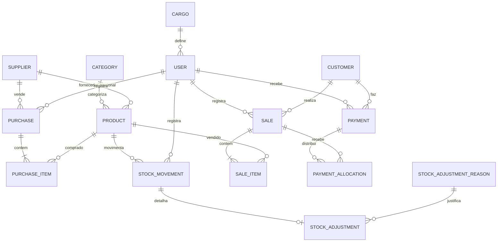

# Arquitetura

## Visão geral

Aplicação monolítica Laravel com páginas Blade renderizadas no servidor. A interface usa CSS compilado pelo Vite/Tailwind e módulos JavaScript nativos para interações localizadas. Não há SPA, camada REST geral ou arquitetura de microsserviços. PostgreSQL é o banco configurado no ambiente Sail; a aplicação também mantém migrações padrão de cache/fila/sessões do Laravel.

## Estrutura e responsabilidades

| Caminho | Responsabilidade observada |
| --- | --- |
| `routes/web.php` | rotas web nomeadas; rotas de negócio ficam sob `auth`, `auth.session`, `active` e `password.changed`, exceto entrada e sessão de login; o módulo Segurança acrescenta `can:manage-users` |
| `app/Http/Middleware` | `EnsureUserIsActive` (derruba conta desativada) e `EnsurePasswordIsChanged` (força a troca de senha temporária) |
| `app/Http/Controllers` | composição de consultas, seleção de views, respostas JSON pontuais, redirects e coordenação da camada de aplicação |
| `app/Http/Requests` | validação e normalização de dados de entrada, incluindo buscas e regras específicas de formulários |
| `app/Actions` | operações de negócio que cruzam registros e precisam de transação, locks ou reutilização explícita |
| `app/Models` | mapeamento Eloquent, relações, casts, estados e cálculos de domínio pequenos |
| `database/migrations` | esquema e constraints; fonte primária da estrutura persistida atual |
| `database/factories`, `database/seeders` | massa de teste/desenvolvimento e dados iniciais quando explicitamente chamados |
| `resources/views` | páginas Blade e componentes compartilhados em `components/ui` |
| `resources/js` | autocomplete, edição de produto, preço/margem, dialogs, formulários dinâmicos e interações de página |
| `resources/css/app.css` | tokens visuais e componentes utilitários globais |
| `tests/Feature`, `tests/Unit` | testes PHPUnit/PHP e Node para fluxos e funções JS |

Não há camada genérica de repositórios nem serviços para cada entidade. Controllers chamam models diretamente para leituras simples e Actions para operações transacionais. Siga esse padrão local antes de propor uma abstração nova.

## Módulos e fluxo de requisição

1. `routes/web.php` encaminha a requisição autenticada para o controller.
2. Um `FormRequest` valida operações de escrita; buscas reutilizam `ListSearchRequest`.
3. O controller consulta Eloquent e monta a view ou chama uma Action.
4. Actions executam escrita em `DB::transaction`, bloqueiam linhas relevantes com `lockForUpdate` e persistem registros relacionados.
5. A resposta renderiza Blade ou retorna JSON nos casos usados pelo drawer/editor; o JavaScript atualiza feedback e listagem.

Grupos de módulos: cadastros (categorias, produtos, clientes, fornecedores), compras, estoque, vendas, pagamentos/contas a receber, autocomplete e Segurança (usuários, exclusivo do Root). A autorização usa os gates nativos `manage-users` e `manage-user`, definidos em `AppServiceProvider`. O dashboard é uma view protegida; não representa por si só um módulo de relatórios.

## Modelo de dados e relações

`categories` tem `is_active` e `has_had_products` (histórico de vínculo usado para impedir exclusão), ausentes na modelagem lógica original (imagem removida em 26/11/2026; o diagrama acima e as migrations são a referência atual). `products.supplier_id` é opcional e aponta para um fornecedor preferencial cadastrado. A compra registra seu próprio fornecedor. Os itens de compra/venda guardam snapshots de custo/preço e quantidade; não existe tabela de parcelas. `PaymentAllocation` é a associação entre um pagamento único e uma ou mais vendas. `StockMovement` liga movimentações a itens de compra ou venda, usuário e, em ajustes manuais, a um detalhe `StockAdjustment` com motivo e saldos anterior/contado. Motivos usam a tabela/model `motivos`; detalhes de ajuste usam `ajustes_estoque`.

`cargos` (`id`, `name`, `slug` único, timestamps) guarda os cargos Root e Administrador, inseridos por migration de dados idempotente. `users` ganhou `cargo_id` (obrigatório, FK `restrict`), `ativo` (padrão `true`), `must_change_password` (padrão `false`) e `last_login_at`. O índice único parcial `users_single_root_unique` (`cargo_id` onde o cargo é o Root) limita o sistema a uma conta Root. Esses três campos de acesso não são `fillable`: só `RegisterUser`, `UserController` e `PasswordController` os gravam, explicitamente.

### Precisão persistida relevante

- `products.sale_price`: decimal de 2; `products.average_cost`: decimal de 4.
- `purchase_items.unit_cost`, desconto e total: decimal de 2.
- `sale_items.unit_price` e subtotal: decimal de 2; `unit_cost`: decimal de 4.
- `stock_movements.unit_cost`: decimal de 4; pagamentos/alocações e totais são decimais de 2.
- Quantidades de estoque e dos itens são inteiras.

Confira os arquivos em `database/migrations/` antes de mudar precisão ou constraints. A apresentação monetária de duas casas não autoriza reduzir a precisão dos dados internos.

## Pontos de entrada do domínio

- `RegisterSale`: snapshot de preço/custo, validação de saldo e baixa de estoque.
- `ConfirmPurchase`: entrada e atualização do custo médio.
- `CancelPurchase`: cancelamento e estorno da entrada, condicionado ao saldo.
- `RegisterStockMovement`: entrada/saída manual com motivo e justificativa.
- `RegisterCustomerPayment`: idempotência por token e alocação cronológica em vendas abertas.
- `LoadAutocompleteOptions` e `AutocompleteController`: carga inicial limitada e busca autenticada assíncrona.
- `RegisterUser`: cria usuárias (comando e módulo Segurança), nunca sobrescreve; Root único sob lock e índice parcial.
- `RevokeUserSessions`: encerra sessões (driver `database`) e troca o `remember_token` ao desativar ou redefinir a senha.

## Navegação principal

`routes/web.php` define CRUD para categorias (com rotas `categories.activate`/`categories.deactivate`), produtos, clientes e fornecedores (com exclusões deliberadamente limitadas); compras permitem listar/criar/ver e confirmar/cancelar; vendas permitem listar/criar/ver; estoque oferece listagem, detalhe/movimentação e cadastro de motivos; perfil de cliente concentra pagamentos e históricos. O autocomplete usa `/opcoes/{source}`. Segurança fica em `/seguranca/usuarios` (`security.users.*`) e a troca da própria senha em `/minha-senha` (`password.edit`/`password.update`). Consulte as rotas reais antes de assumir operações disponíveis.
